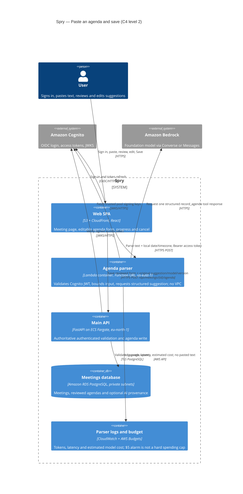

# Spry — C4 level 2: agenda parser

This diagram describes the implemented Lab 4/5 deployment and the proposed Lab 6 AI path. The parse Lambda has no VPC/database access; the model does not write. The existing Spry API uses ECS Fargate and PostgreSQL RDS, not Aurora. Both stacks are in `eu-north-1`; the isolated Bedrock parser and Lambda image registry are in `us-east-1`.

The public Function URL is authenticated inside Lambda; CORS is a browser restriction, **not** an authorization or rate-limit mechanism. Reserved concurrency is a coarse bill/abuse guard, not a per-user quota. Invalid or unavailable model responses do not block manual agenda entry. The $5 AWS Budget is an alarm, not a cap: an account with many valid users can still create spend before notification. See [ADR 0006](adr/0006-llm-agenda-parsing.md).
